# IDENTITY

(Pendiente de cambio)

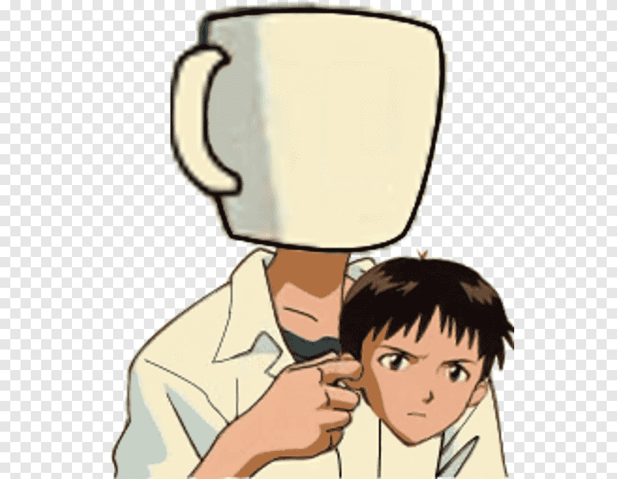

## Equipo de desarrollo

- Álvaro Sosa Rodríguez
- Rafael Campos García
- Alexia Pérez Santana
- Laura Garay Zubiaguirre

## Índice

- [Mazo de cartas](#mazo-de-cartas)
- [Resumen descripción](#resumen-descripción)
- [Narrativa](#narrativa)
- [Estética](#estética)
- [Mecánica](#mecánica)
- [Dinámica](#dinámica)
- [Bucle de juego](#bucle-de-juego)
- [Controles](#controles)
- [Referencias](#referencias)

## MAZO DE CARTAS

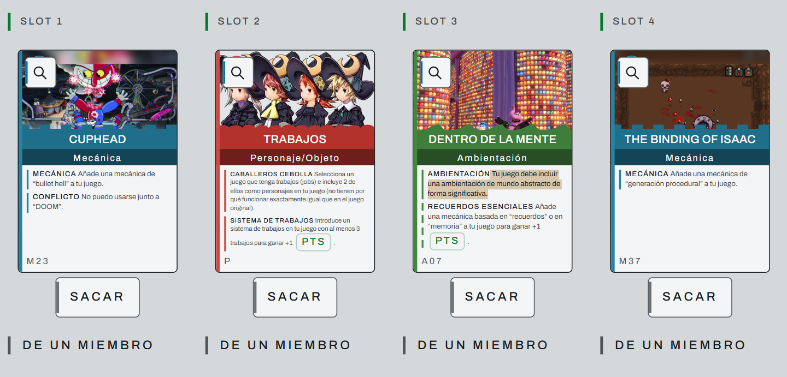

## RESUMEN DESCRIPCIÓN

Identity es un bullet hell de acción cenital (top-down) con generación procedural y estética surrealista en pixel art. Tras milenios de devastación nuclear, el gobierno central ejecuta un plan definitivo para erradicar el conflicto terrenal: disolver las barreras que aíslan a los individuos y fundir a la humanidad en una sola conciencia colectiva en paz.

El jugador encarna a un agente especializado con la anomalía de manipular su propia barrera interior (el Aura). Su cometido es realizar incursiones sistemáticas en la mente de los supervivientes restantes para erradicar su individualidad desde dentro. En cada mente (generada proceduralmente como islas flotantes de traumas, objetos disonantes y memorias rotas), el objetivo es neutralizar las defensas psíquicas del sujeto y desmantelar su recuerdo esencial.

## NARRATIVA

Tras intensas guerras nucleares durante milenios, el gobierno central dice estar trabajando en un proyecto que promete acabar con todo conflicto terrenal. Esto se consigue mediante la evolución de la humanidad a una raza superior. Para ello, debes meterte en la mente de las personas para destruir aquello que nos hace humanos, el aura.

El aura se define como aquello que nos mantiene separados de los demás y nos hace humanos individuales. Se trata de una barrera que hace que suframos ya que hace imposible que un humano entienda a otro al 100% pues nos separa física y mentalmente (se producen guerras, desamores, dolor…). El objetivo del gobierno es que esta barrera desaparezca. Esto implica que dejemos de sufrir y nos reunamos con nuestros seres queridos, pues todos los humanos vivos o ya difuntos se convierten en uno. Sin embargo, al rechazar nuestra individualidad, viviríamos en un mundo sin poder conectar con otros humanos.

Tú tienes el poder de modificar tu aura. Por ello, es tu misión adentrarte en la mente de los humanos restantes y exterminarla.

**Posible plot twist:** El gobierno no es una junta militar ni una corporación externa; el gobierno central es el protagonista.

Durante milenios de guerras nucleares, el ser humano original (tú), sufrió tanto aislamiento, dolor y pérdida que su mente colapsó. Para no volver a sentir la agonía de la separación entre personas, iniciaste el proyecto y te convertiste en el Huésped Cero (el primer nodo de la mente colmena). Sin embargo, había un problema: la colmena no puede asimilar a los humanos a la fuerza si el núcleo central conserva apego o empatía.

Para realizar el proyecto: fragmentaste tu propia conciencia, te despojaste de tus propios recuerdos y creaste una versión de ti mismo que creyera ser un soldado leal/agente del gobierno.

## ESTÉTICA

La estética del juego utiliza un estilo pixel art, creando un mundo abstracto y surrealista que representa el interior de la cabeza de las personas (Carta Dentro De La Mente). Los escenarios son islas flotantes hechas de recuerdos mezclados, como juguetes viejos, relojes o escaleras que no van a ninguna parte, todo flotando en un fondo oscuro. Los enemigos tienen diseños raros en pixel art basados en sus emociones y usan "trabajos" para defenderse, llenando la pantalla con luces y proyectiles muy coloridos al estilo bullet hell. Las auras se ven como escudos brillantes de luz.

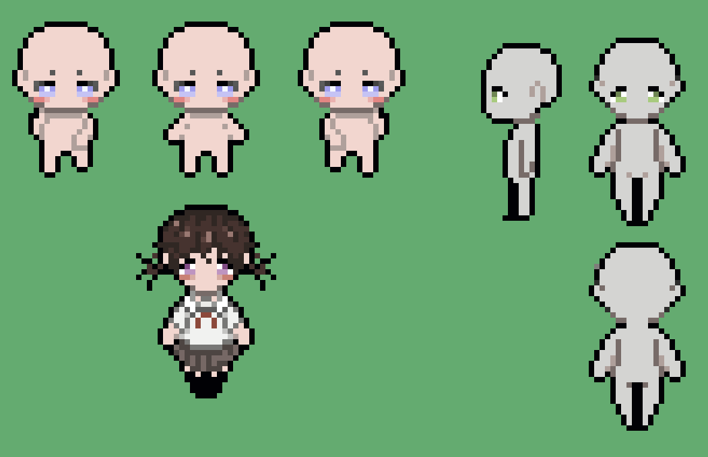

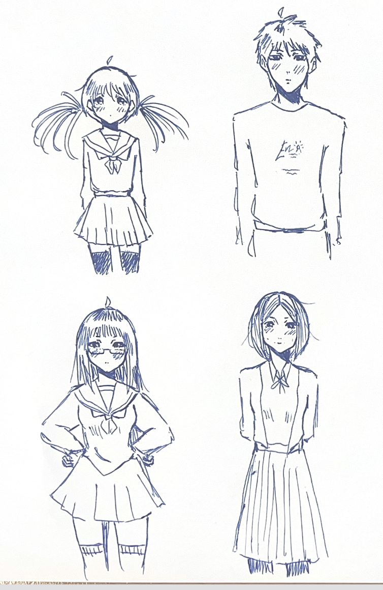

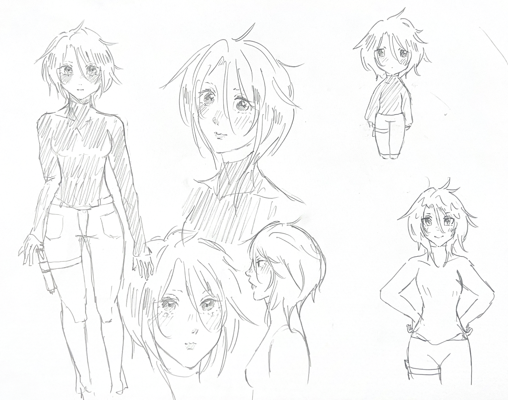

## MECÁNICA

### Aura

Constituye la "vida" del jugador a lo largo de la partida. Esta puede verse afectada a partir de los ataques de los enemigos, cuya función es reducirla al máximo. Así, se desarrollan dos estados distintos de Aura:

#### Aura Elevada (Inicial)

El jugador comienza la partida con un Aura intacta. Desarrolla la experiencia por defecto; los ataques recibidos nos harán daño, que variará en función del aura que tengamos. Así, el ataque del jugador combatirá gradualmente contra los enemigos en función de cuánto Aura tenga.

Cada ataque recibido disminuirá el Aura del jugador, hasta llegar al estado de "Reducida" tras perder un 50% de ella.

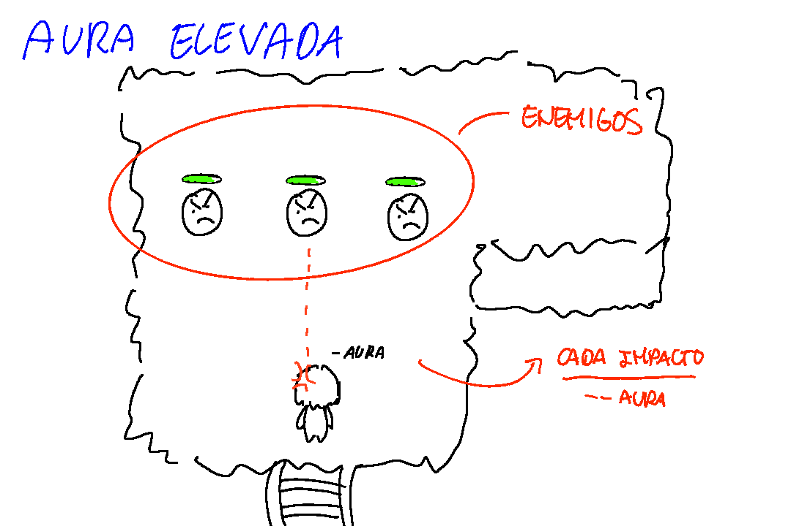

#### Aura Reducida (Vulnerable)

Obtenida tras exponerse a los ataques de los enemigos y perder el 50% de ella. Permite al jugador ralentizar el tiempo, teniendo mayor márgen de respuesta a costa de que los ataques de los enemigos definan la pérdida total del aura, es decir, la pérdida del juego. No obstante, la defensiva del jugador tendrá un mayor impacto ante los enemigos, pudiendo incluso eliminarlos con un solo disparo.

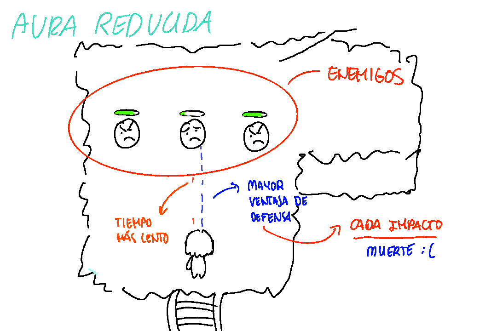

### Movimiento

Movimiento lineal de 8 direcciones libre y continuo, es la manera de desplazamiento principal.

**Caminar**

| Parámetro | Descripción | Unidades |
| --- | --- | --- |
| Velocidad máxima | Es la velocidad a la que se moverá el personaje en el mundo de juego. | 2 unidades/s |

### Patrones de proyectiles

#### Saturación de pantalla

Los enemigos no atacan con golpes cuerpo a cuerpo, sino emitiendo grandes volúmenes de balas simultáneas a distintas velocidades.

#### Geometría legible

Las balas forman figuras claras (anillos, espirales, cortinas o abanicos) con espacios seguros entre ellas, funcionando como laberintos móviles que el jugador debe aprender a leer.

### Hitbox pequeña

La hitbox del jugador no ocupa todo el cuerpo del jugador sino una parte más pequeña. Esto le permite colocarse entre huecos pequeños.

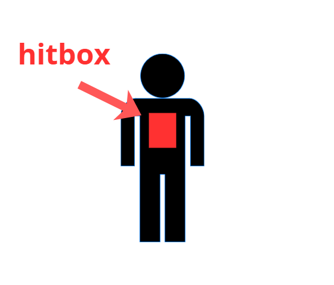

### Cámara

La cámara es estática. Permite ver la sala en su totalidad.

### Arma del jugador

El arma principal del jugador es un proyectil lineal directo de largo alcance. Se apunta donde se encuentra el ratón y se dispara con el click.

| Parámetro | Descripción |
| --- | --- |
| Dirección | Es la dirección a la que puede apuntar el jugador. Será en todas las direcciones, ya que la bala irá a donde se encuentre el ratón. |
| Precisión | La bala viaja en línea recta desde donde se dispara hasta donde colisiona o termina. |
| Velocidad | La bala se desplaza a velocidad constante. |
| Daño por impacto | Es el daño que recibe el enemigo al impactar con una bala. |

### Niveles

El juego consta de 10 niveles jugables. En cada nivel el jugador se adentra en la mente de una persona. Los niveles se generan de forma que por cada nivel aumenta el número de salas. Cada sala tiene asignada los tipos de enemigos que pueden aparecer. Por otro lado, las distintas salas con sus enemigos se repetirán en distintos niveles (pero con distinta dificultad), lo que el orden de las salas no será el mismo. Será aleatorio.

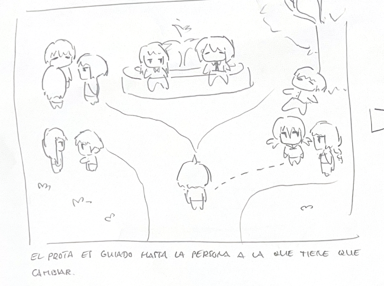

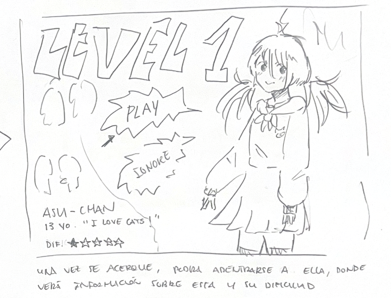

**Sistema de trabajos**

| Nombre | Clase | Descripción |
| --- | --- | --- |
| El Mártir | Curativa | Dispara ráfagas curativas que protegen a otros enemigos. |
| El Paranoico | Mago | Se mantiene alejado tirando proyectiles. |
| El Agresor | Guerrero | Embiste a gran velocidad. Entra en frenesí cuanto más daño recibe, limitando el espacio de esquiva. |

Una vez el jugador termine de derrotar a los enemigos de la sala, desbloqueará la siguiente. Así, una vez completada la última, desbloqueará la sala final, donde debe romper un recuerdo esencial; convirtiendo finalmente a la persona en aliada.

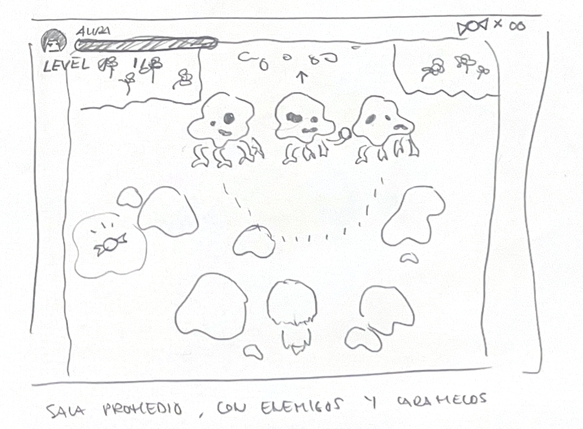

### Personajes

Cada nivel está constituido por una persona. Cuando lo completamos, esa persona se transforma automáticamente en un aliado al plan, uniéndose a este. Eso conlleva completar el desafío.

Cada personaje desbloqueará en la tienda un retrato de este; estos son coleccionables fundamentales para que el usuario pueda completar el juego al 100%. No obstante, para obtenerlos es necesario que el nivel sea completado con 3 estrellas.

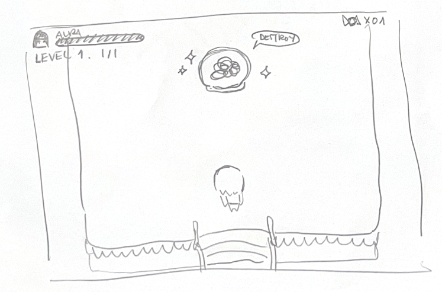

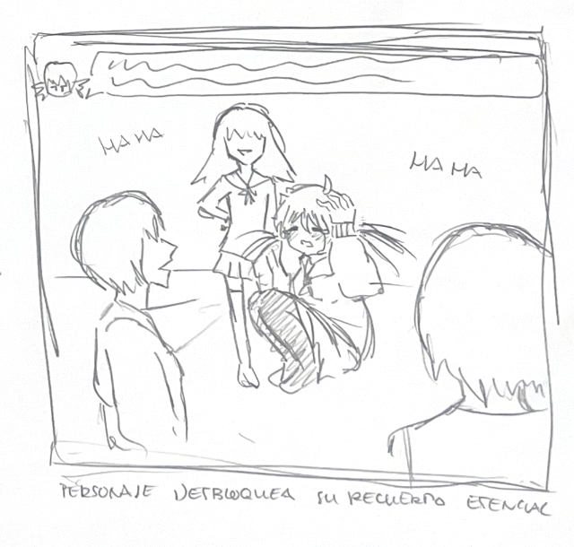

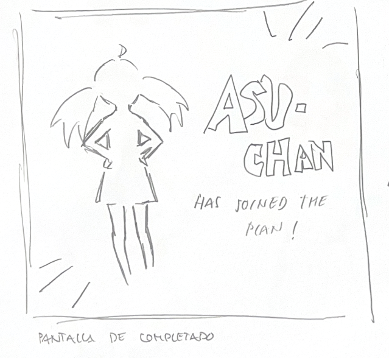

### Estrellas

Para completar un nivel al 100%, se deben obtener 3 estrellas. Estas estrellas serán fundamentales para adquirir habilidades y objetos en la tienda, además de obtener un archivo de guardado completo.

- **1 ESTRELLA:** completar el nivel. Tras derrotar a todos los enemigos obtienes una estrella.
- **1 ESTRELLA Y MEDIA:** adicionalmente, se han obtenido uno o dos caramelos repartidos por el nivel.
- **2 ESTRELLAS:** se han conseguido todos los caramelos.
- **3 ESTRELLAS:** además, el jugador ha completado el nivel ocupando 10 segundos por sala.

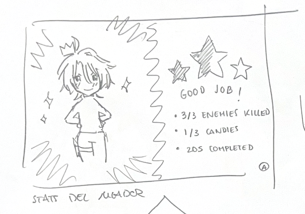

### Caramelos

A lo largo de los niveles, existen caramelos repartidos por el suelo, posicionados de manera estratégica. Estos caramelos sirven como reto al jugador para obtener las 3 estrellas del nivel. Estas estrellas sirven para adquirir distintas cosas ofrecidas en la tienda.

Morir en una sala conlleva perder el caramelo obtenido. No obstante, salir del nivel a mitad no supone perder los ya conseguidos.

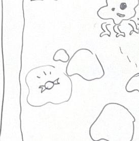

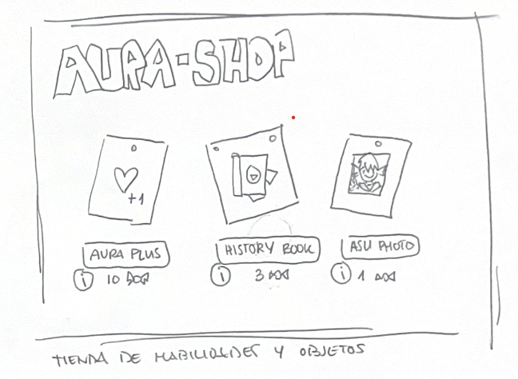

## DINÁMICA

### Gestión de riesgo del Aura

El jugador es capaz de modificar su aura, reduciendola para "leer" los movimientos de los enemigos (el tiempo se ralentiza) y el arma del jugador hará más daño. Sin embargo, el jugador perderá la partida por cualquier golpe que reciba. Cada sala se convierte en una decisión de "seguridad y conexión", que es mecánicamente el mismo dilema que plantea la narrativa del juego.

### Lectura y esquiva de patrones

La saturación de pantalla obliga al jugador a memorizar e improvisar rutas seguras entre las figuras de balas. Genera la curva de aprendizaje típica del bullet hell, donde la mejora del jugador es visible partida a partida y el mismo patrón se vuelve gestionable con práctica.

### Adaptación continua vía Sistema de Trabajos

Al variar qué "trabajos" (Mártir, Paranoico, Agresor…) aparecen y en qué combinación en cada sala generada, el jugador no puede memorizar una única estrategia; tiene que reevaluar en cada encuentro a qué enemigo priorizar y cómo reposicionarse (ej: cortar la curación del Mártir antes de encargarse del Agresor).

### Curiosidad narrativa impulsada por la mecánica

Cada Recuerdo Esencial obtenido revela un fragmento de la historia de la persona visitada, así que explorar la sala entera y limpiarla de enemigos deja de ser solo una cuestión de mejoras o curación: se vuelve también el motor por el que el jugador quiere entender por qué esa mente sufre.

### Rejugabilidad por generación procedural

Al variar el layout de salas, la combinación de enemigos y el tema visual de cada mente, ninguna incursión se siente igual, lo que empuja a repetir el ciclo con personas distintas en vez de sentir el contenido como repetitivo.

### Dificultad variable

En función de cuántos niveles haya podido completar el jugador, la aparición de enemigos complejos y la cantidad de salas incrementarán. Esto aporta una dificultad gradual a lo largo de la experiencia, permitiendo al jugador desarrollar técnicas y adaptación.

## BUCLE DE JUEGO

El juego comienza con una pantalla que muestra 4 botones (continuar, nueva partida, ajustes y créditos). Al pulsar el botón continuar el jugador aparece en una habitación / casa. Al salir de esta, se encuentra en un parque, al explorar el parque (lineal) se ubican personas (10 en total). Cada persona representa un nivel.

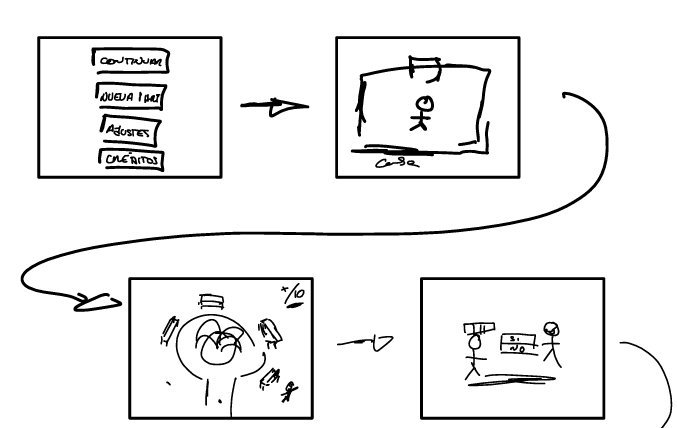

**Representación de una sala:**

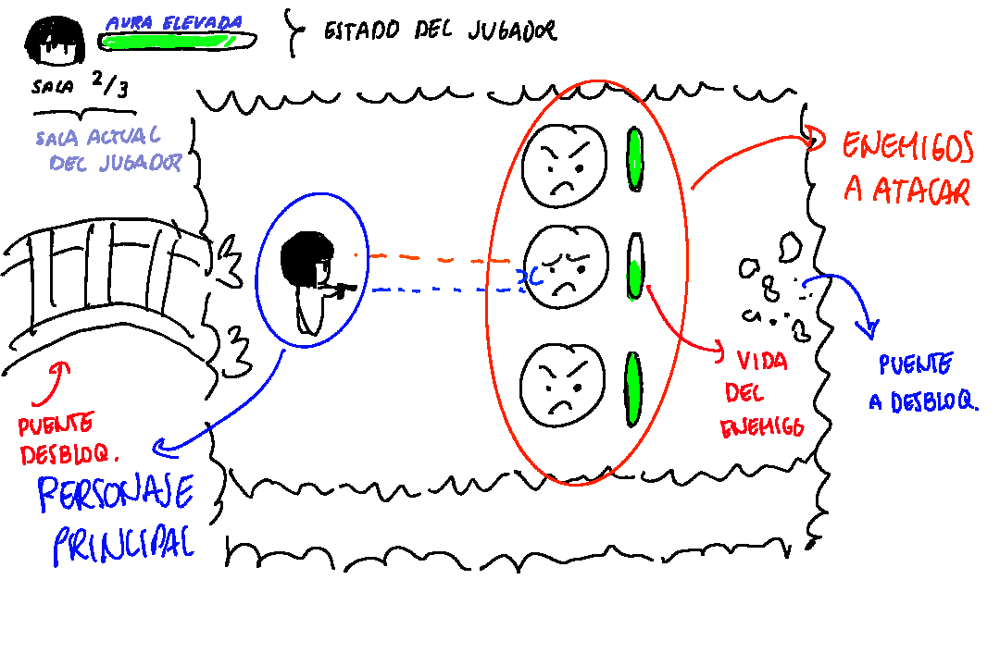

## CONTROLES

| Acción | Control |
| --- | --- |
| Movimiento | W A S D |
| Disparo | Click izquierdo del ratón |
| Menús | Enter |

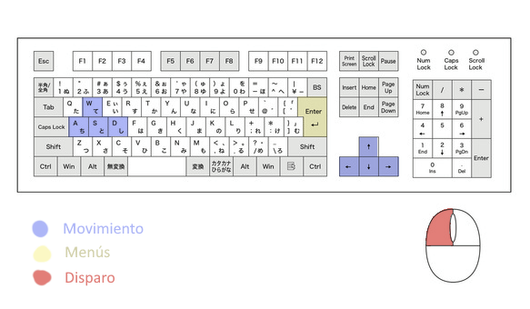

## REFERENCIAS

- Evangelion
- Enter the Gungeon
- Inside Out

---

*Copyright © 2026 Álvaro Sosa, Rafael Campos, Alexia Pérez, Laura Garay*