# IDENTITY

> Proyecto universitario realizado para la asignatura **Programación de Videojuegos en Lenguajes Interpretados (PVLI)** — Universidad Complutense de Madrid, curso 2026/2027.

**Estudio:** Burnt Bistec

## Jugar

### **[ Jugar a IDENTITY en el navegador](https://espectral55.github.io/PVLI/)**

## Descripción

Identity es un **bullet hell de acción cenital (top-down)** con generación procedural y estética surrealista en pixel art.

Tras milenios de devastación nuclear, el gobierno central quiere disolver las barreras que aíslan a las personas, su **aura**, y fundir a la humanidad en una sola conciencia colectiva en paz. Tú eres un agente capaz de manipular tu propia aura, y tu misión es entrar en la mente de los supervivientes que quedan para enfrentarte a sus traumas y destruir su recuerdo esencial.

En el parque te esperan 10 personas: cada una es un nivel. Dentro de su mente, las salas son islas flotantes llenas de enemigos que llenan la pantalla de balas. Al limpiar todas las salas, rompes su recuerdo esencial y la persona se une al plan.

## Capturas

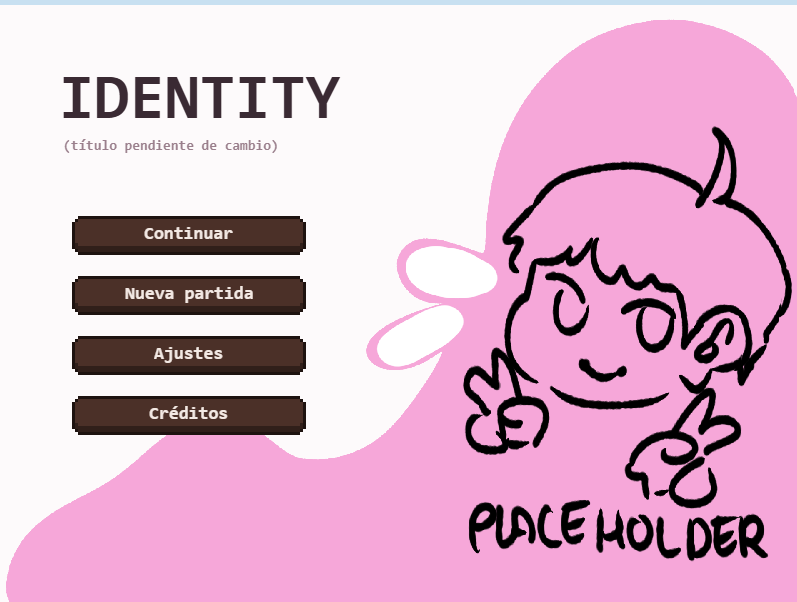

| Casa | Parque |
| --- | --- |
| 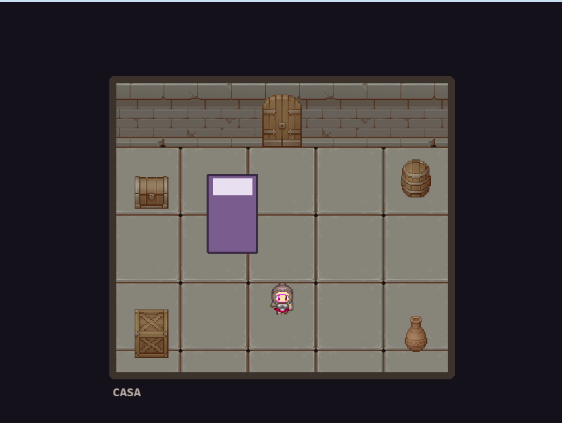 | 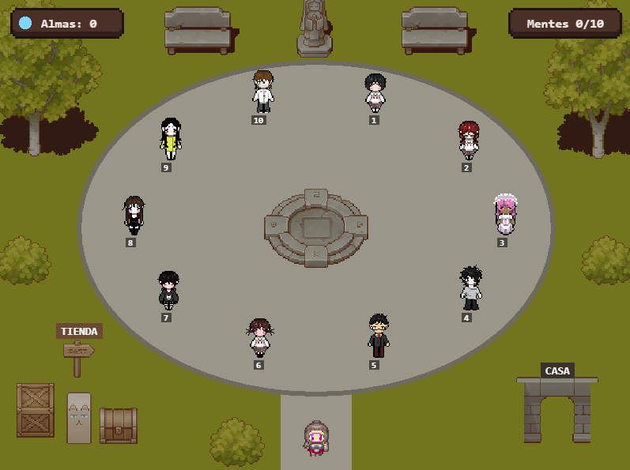 |

| Elegir nivel | Sala de la mente |
| --- | --- |
| 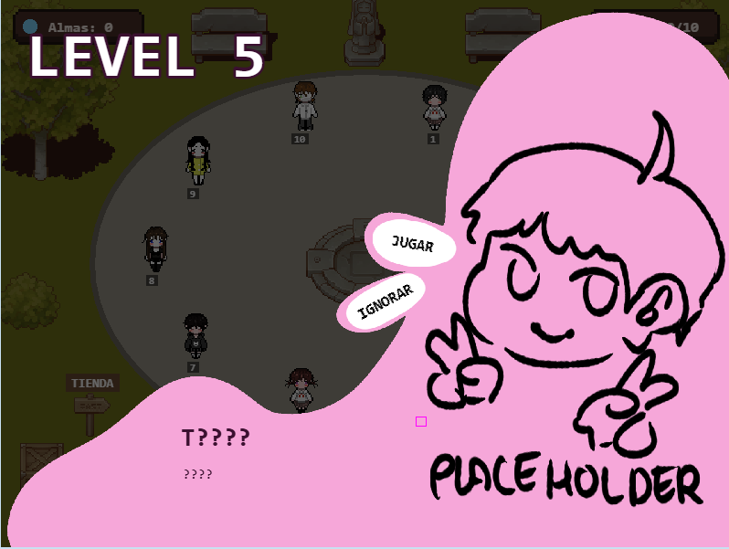 | 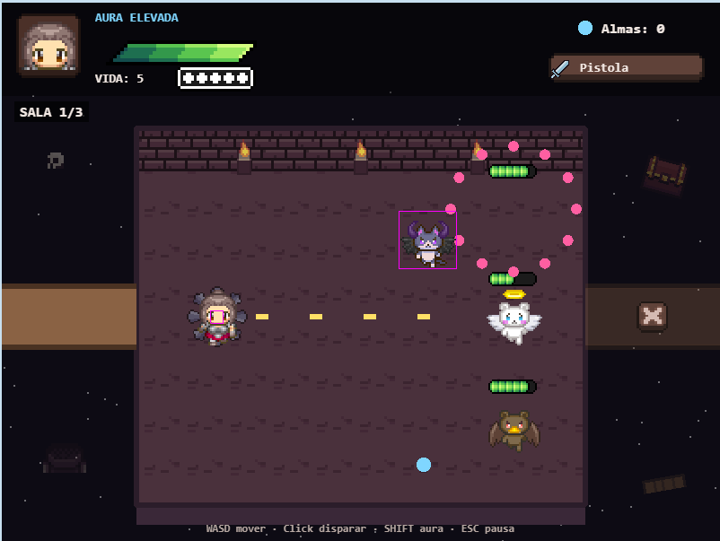 |

| Tienda | Pausa |
| --- | --- |
| 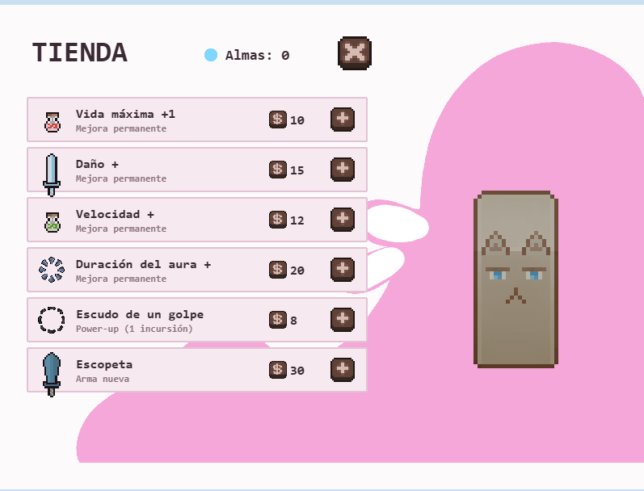 | 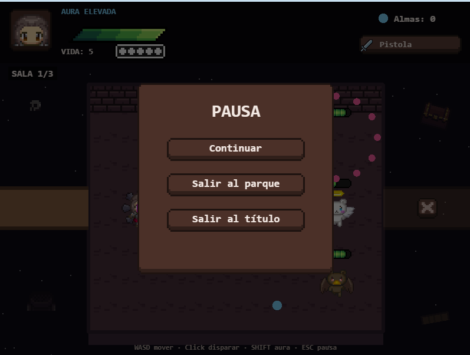 |

| Mente completada | Game Over |
| --- | --- |
| 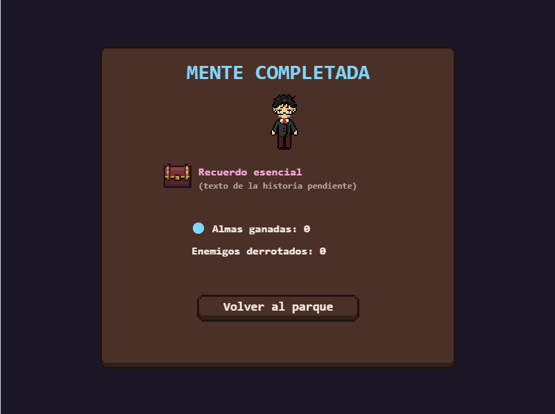 | 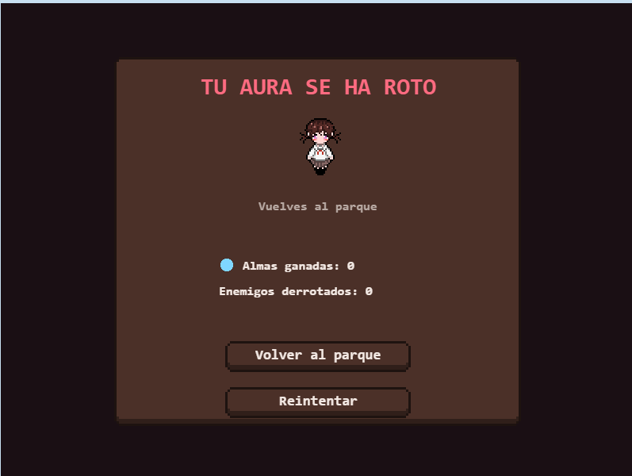 |

| Ajustes | Créditos |
| --- | --- |
| 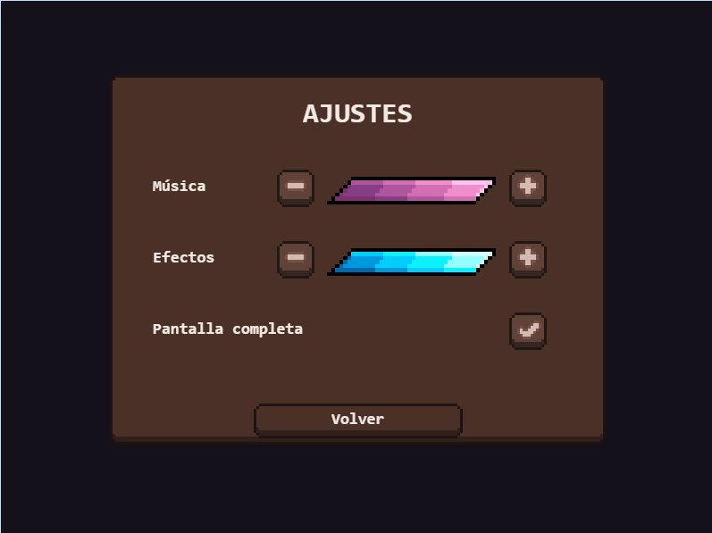 | 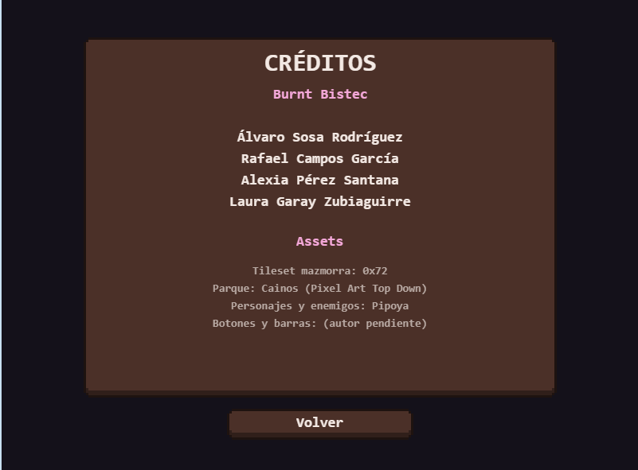 |

## Controles

| Acción | Control |
| --- | --- |
| Moverse | W A S D |
| Disparar | Click izquierdo (apunta al ratón) |
| Pausa | ESC |

## Equipo

- Álvaro Sosa Rodríguez
- Rafael Campos García
- Alexia Pérez Santana
- Laura Garay Zubiaguirre

## Redes sociales

- Instagram: [@bistecstudios](https://www.instagram.com/bistecstudios/)

## Documentación

- [GDD (documento de diseño)](GDD.md)
