# Registro de Assets

Este documento recopila los recursos visuales utilizados en el proyecto, su propósito, autoría y licencias correspondientes.

---

## 1. Fondos y Pantallas de Menú

### Pantalla de Título
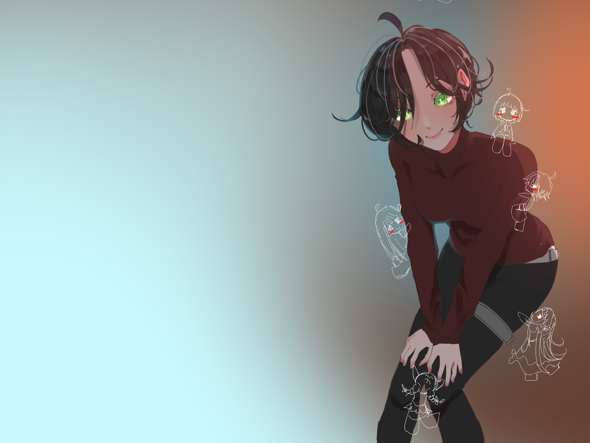

* **Archivo:** `assets/titlescreen.png`
* **Descripción:** Imagen principal de la pantalla de inicio / título del juego.
* **Autor:** Creación propia (Rafael Campos García)
* **Licencia:** Proyecto académico / Uso interno

---

### Personajes pixel art
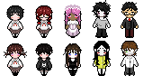

* **Archivo:** `assets/CharactersLevelSelect.png`
* **Descripción:** Distintos personajes en pixel art.
* **Autor:** Creación propia (Rafael Campos García)
* **Licencia:** Proyecto académico / Uso interno

---

## 2. Personaje Principal y Jugabilidad

### Animaciones de la Protagonista (Original)
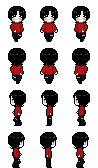

* **Archivo:** `assets/MainCharacterAnim.png`
* **Descripción:** Hoja de sprites con las animaciones de movimiento y acciones del personaje principal.
* **Autor:** Creación propia (Rafael Campos García)
* **Licencia:** Proyecto académico / Uso interno

---

### Placeholder de Personaje

  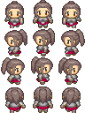
  

* **Archivos:** `assets/MainCharacterPlaceholder.png` y `assets/player.png`
* **Descripción:** Sprites temporales utilizados durante las pruebas mecánicas y de movimiento.
* **Autor:** Desconocido
* **Licencia:** Proyecto académico / Uso interno

---

### Proyectil Azul (Blue Bullet)

* **Archivo:** `assets/blue_bullet.png`
* **Descripción:** Sprite del proyectil azul disparado en la escena Room.
* **Fuente:** Gráfico extraído del emoji "Blue Circle" (🔵) de Apple iOS 10.0 (vía Emojipedia / biblioteca de emojis de Apple).
* **Autor / Propietario:** Apple Inc.
* **Licencia:** Copyright © Apple Inc. (Uso no oficial bajo consideración de ámbito educativo / prototipo académico).

---

## 3. Interfaz de Usuario y Efectos

### Barras de Vida (HealthBars)
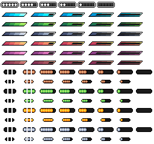

* **Archivo:** `assets/HealthBars.png`
* **Descripción:** Elementos de la interfaz para representar la salud del jugador y de los enemigos.
* **Fuente:** Pixel Lab (pixlab24.com) / Repositorio abierto de assets
* **Autor:** Desconocido (Recurso web abierto)
* **Licencia:** Gratuita para uso no comercial y académico (CC0 / Dominio Público)

---

### Efectos Visuales (Effects)
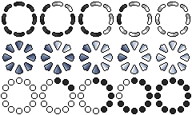

* **Archivo:** `assets/Effects.png`
* **Descripción:** Efectos visuales de impacto, partículas y estados.
* **Autor:** Desconocido (Recurso web abierto)
* **Licencia:** Gratuita para uso no comercial y académico (CC0 / Dominio Público)

---

## 4. Niveles, Bases y Popups

### Base de Personajes
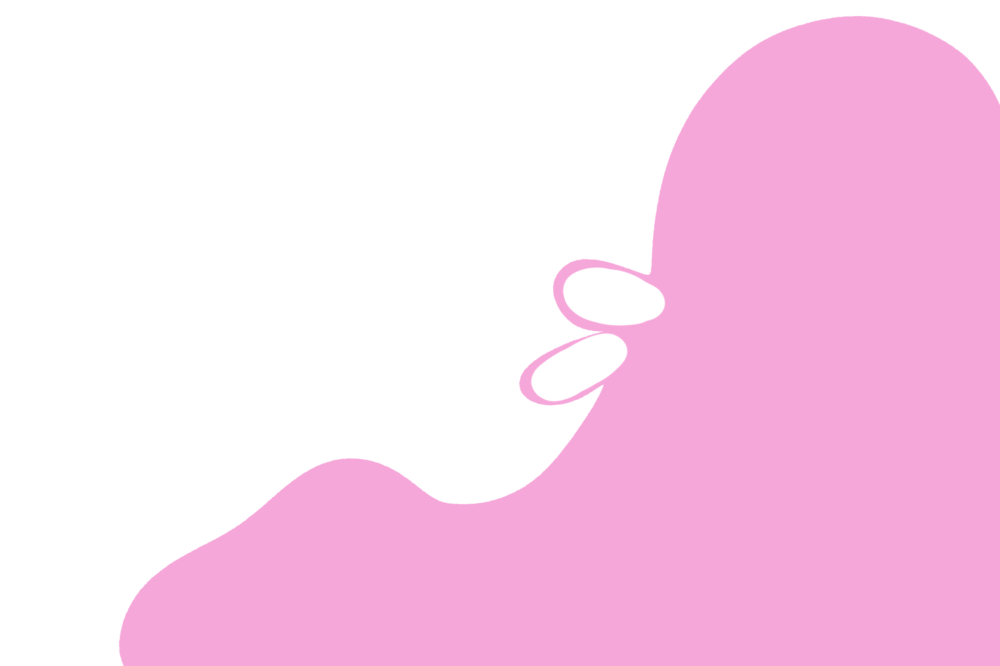

* **Archivo:** `assets/Base.png`
* **Descripción:** Base gráfica que sirve de plantilla para añadir los personajes en escena.
* **Autor:** Rafael Campos García
* **Licencia:** Proyecto académico / Uso interno

---

### Secuencias y Popups de Niveles (Level 1 al Level 10)

  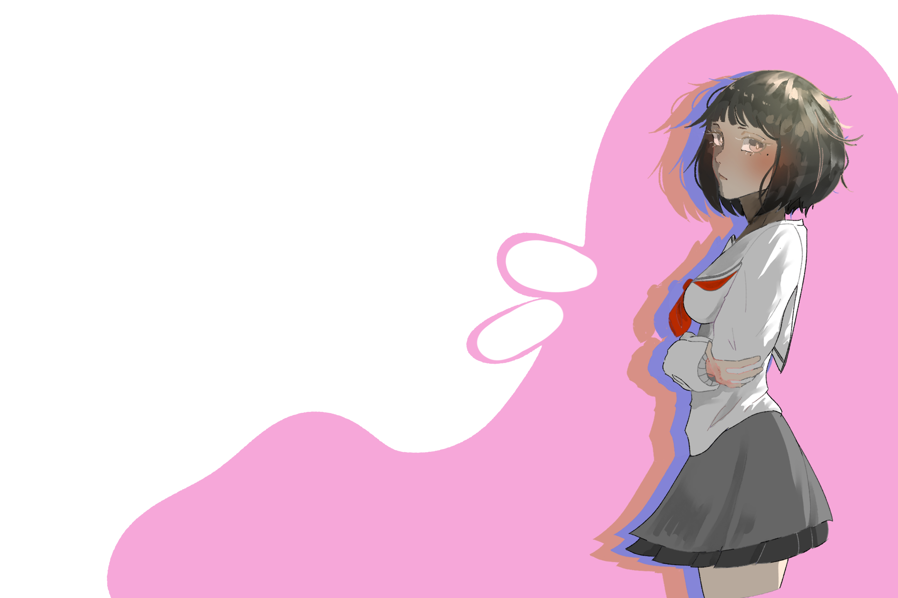
  
  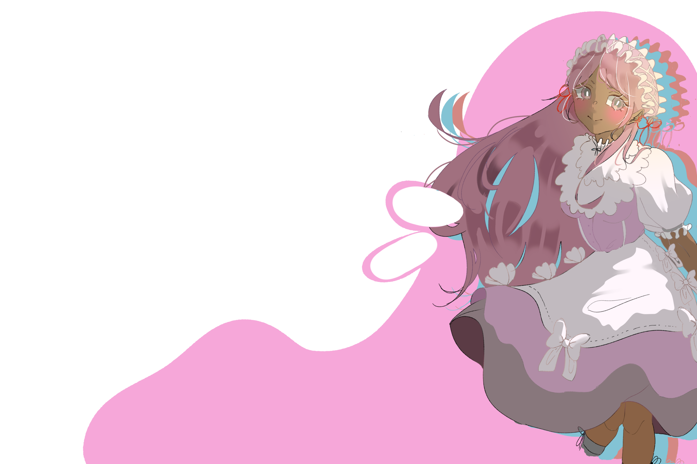
  
  
  
  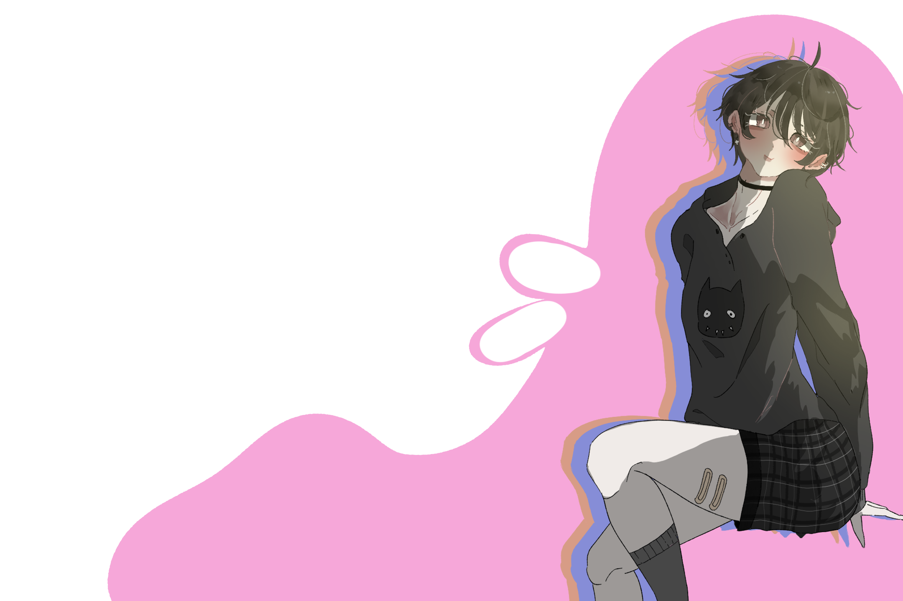
  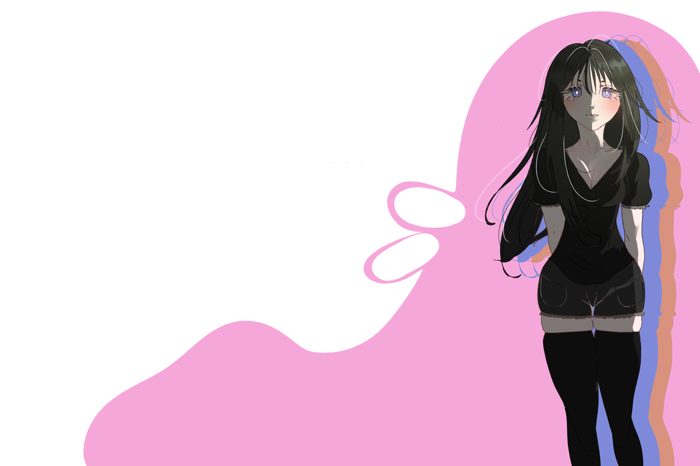
  
  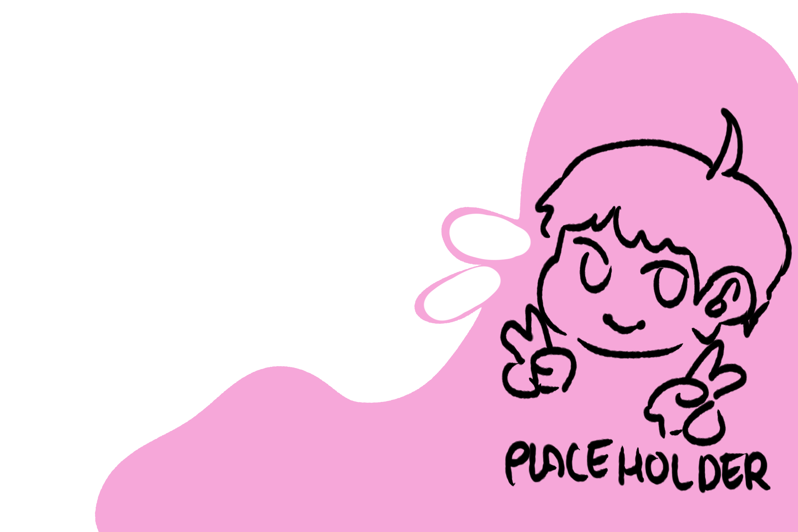

* **Archivos:** `assets/Level1.png` hasta `assets/Level10.png`
* **Descripción:** Ilustraciones y popups utilizados en las cinemáticas (cutscenes) y presentaciones de los personajes a lo largo de cada nivel.
* **Autor:** Rafael Campos García
* **Licencia:** Proyecto académico / Uso interno

## 5. Memorias y Cutscenes (`assets/Memories/`)

  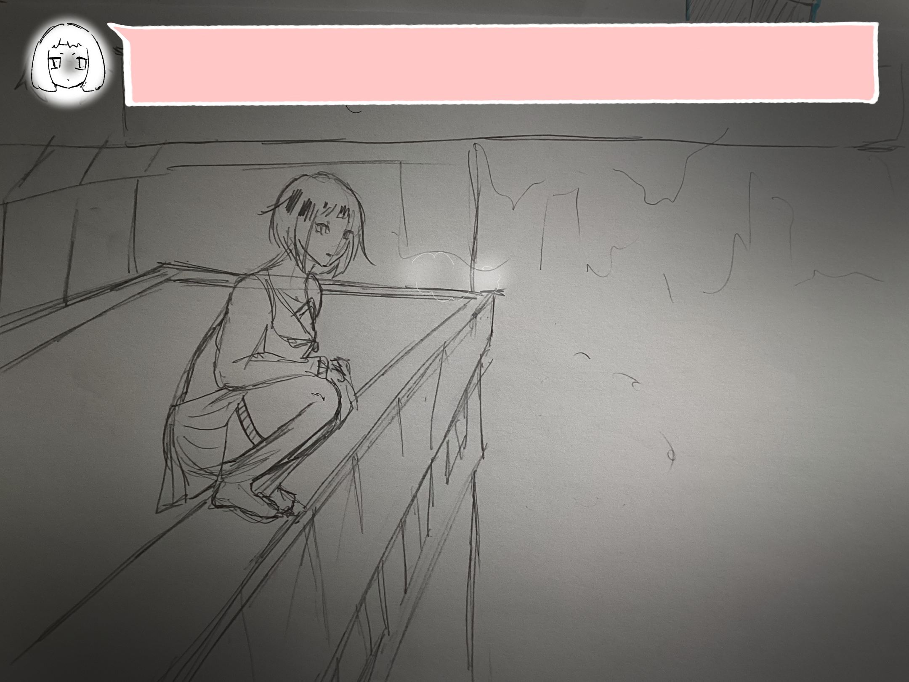
  
  
  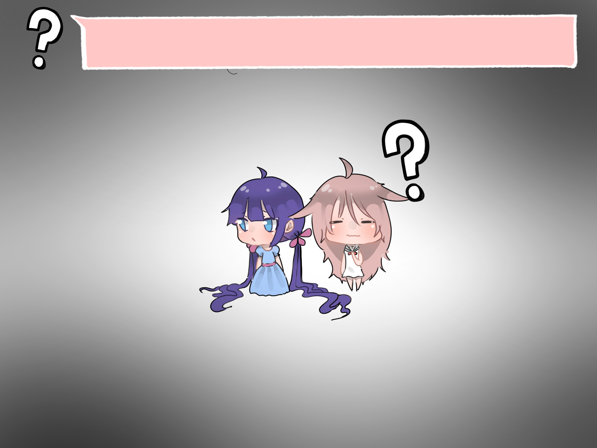
  
  
  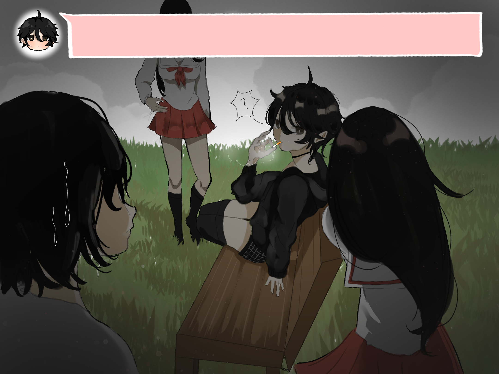
  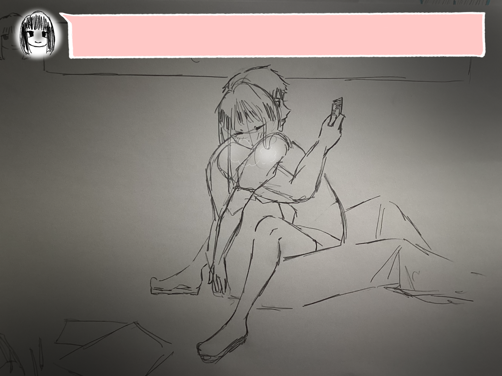
  
  

* **Archivos:** `assets/Memories/memory1.png` hasta `assets/Memories/memory10.png`
* **Descripción:** Ilustraciones utilizadas en las secuencias narrativas y cinemáticas (cutscenes) de cada nivel.
* **Autor:** Rafael Campos García
* **Licencia:** Creación propia / Uso académico interno

---

## 6. Tileset de Niveles (`assets/LevelTileset/`)

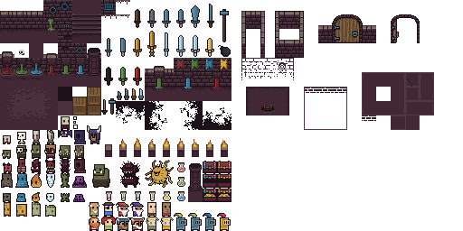

* **Archivo:** `assets/LevelTileset/0x72_16x16DungeonTileset.v5.png`
* **Descripción:** Tileset de mazmorra (16x16) para la construcción de los escenarios y niveles del juego.
* **Fuente:** Repositorio público / itch.io (*16x16 Dungeon Tileset*).
* **Autor:** Robert (0x72)
* **Licencia:** CC0 1.0 Universal (Dominio Público) / Gratuita para uso no comercial y comercial

---

## 7. Enemigos (`assets/Enemies/`)

  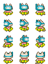
  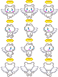
  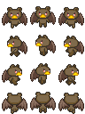
  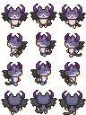

* **Archivos:** 
  * `assets/Enemies/pipo-nekonin012.png`
  * `assets/Enemies/pipo-nekonin019.png`
  * `assets/Enemies/pipo-nekonin020.png`
  * `assets/Enemies/pipo-nekonin027.png`
* **Descripción:** Sprites de personajes y enemigos tipo ninja/gato (*Nekonin*) con sus animaciones para el combate.
* **Fuente:** Colección de sprites RPG / itch.io / Pipoya
* **Autor:** Pipoya (pipo / pipoya.itch.io)
* **Licencia:** Gratuita con atribución / Licencia libre para desarrollo de videojuegos (CC-BY / Pipoya Free Asset License)

---

## 8. Mapa de Selección de Nivel (`assets/CourseSelectMap/`)

  
  
  
  
  
  
  
  
  

* **Archivos:**
  * `assets/CourseSelectMap/TX Plant.png`
  * `assets/CourseSelectMap/TX Player.png`
  * `assets/CourseSelectMap/TX Props.png`
  * `assets/CourseSelectMap/TX Shadow Plant.png`
  * `assets/CourseSelectMap/TX Shadow.png`
  * `assets/CourseSelectMap/TX Struct.png`
  * `assets/CourseSelectMap/TX Tileset Grass.png`
  * `assets/CourseSelectMap/TX Tileset Stone Ground.png`
  * `assets/CourseSelectMap/TX Tileset Wall.png`
* **Descripción:** Colección de tilesets modulares de terreno (hierba, piedra, muros), sombras, props y vegetación para la escena de mapa de selección de fases.
* **Fuente:** Pack de texturas *TX Tileset / RPG Top-Down Tileset* (comunidad OpenGameArt / itch.io).
* **Autor:** Desconocido / Varios artistas (Pack de assets públicos)
* **Licencia:** CC0 (Dominio Público) / Licencia libre para prototipos académicos

---

## 9. Botones de Interfaz (`assets/Buttons/`)

  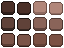
  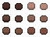
  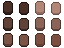
  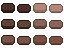
  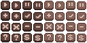

* **Archivos:**
  * `assets/Buttons/ClassicalButtons.png`
  * `assets/Buttons/LittleButtons.png`
  * `assets/Buttons/LongButtons.png`
  * `assets/Buttons/LongButtons2.png`
  * `assets/Buttons/freebuttons2.png`
* **Descripción:** Conjunto de botones de interfaz de usuario (UI) para menús principales, botones de confirmación y selección de niveles.
* **Fuente:** Repositorios de recursos UI gratuitos para pixel art / OpenGameArt.
* **Autor:** Desconocido (Recurso web abierto)
* **Licencia:** Gratuita para uso no comercial y formativo (CC0 / Licencia libre)
